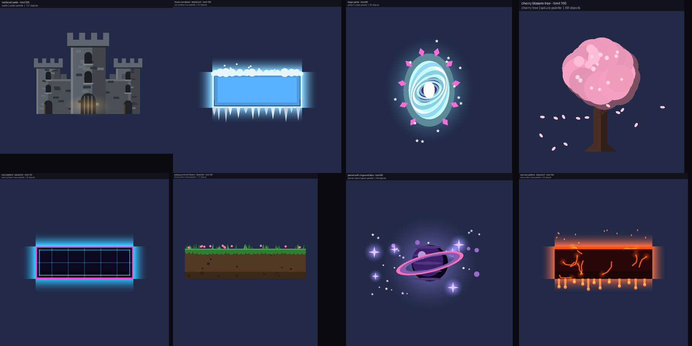

# AI Deco — Geode mod for Geometry Dash

Hover a block in the editor, describe how it should look, and get a finished, layered decoration.
Works fully offline with a built-in design engine; optionally uses Claude for free-form requests.



*Previews above come from `tools/preview` (an approximate renderer of the same engine), not in-game screenshots.*

## Features
- **Hover to decorate**: an `AI` button follows the block under your cursor; **Alt+G** opens the popup for whatever is under the cursor. Toolbar button too.
- **Describe it**: themes, subjects, surfaces, colors, sizes ("big", "tiny"), "glowing", "detailed", "minimal", "background", "pixel".
- **Object limit slider (5–1000)**: detail scales up/down to fit; optional detail is dropped first (sparkles → glow → highlights → shading → silhouette).
- **Structure-aware**: flood-fills the touching blocks, merges them into rectangles, finds exposed top/bottom/side edges, and dresses them (grass lips, snow lumps, icicles, drips, vines, crystals, trims, edge glow, brick/panel/strata patterns).
- **Auto colors**: picks unused color channels, writes the palette into them (glow channel gets additive blending). One channel per palette role, reused when you reroll the same theme.
- **One undo step**, objects are selected afterwards, `No Touch` on by default so deco never affects gameplay.
- **Claude mode (optional)**: sends your request, the structure geometry, the procedural draft and your saved examples; Claude answers with primitives in the same format. Needs your own API key.
- **Example library**: save any selection as a named example; matching descriptions reuse it (and Claude gets it as a style reference). Drop shared `.json` packs into the examples folder.

## Building
The easiest way is GitHub Actions:
1. Create a GitHub repo and push this folder.
2. The workflow in `.github/workflows/build.yml` builds Windows, macOS, iOS and Android and uploads `valkicial.ai-deco.geode` as an artifact.
3. Download it and drop it into your Geode `mods` folder (or install via Geode's "install from file").

Locally (with the [Geode CLI](https://docs.geode-sdk.org/getting-started/geode-cli) and SDK installed):
```
geode build
```

### Versions
Targets **Geode v5.11.2 / Geometry Dash 2.2081** (the current stable Geode). Geometry Dash 2.209 requires Geode v6, which is still in alpha;
porting means bumping `mod.json` and adapting to v6's `TextInput`/`SliderNode` changes.

## How the engine works (`src/core`, no Geode dependency)
1. `Spec.cpp` parses the description into a theme palette (8 roles: base, mid, light, accent, glow, foliage, bloom, wood), subjects, surfaces and modifiers.
2. `Recipes.cpp` draws subjects from primitives (rect, slope, circle, ring, triangle, star, diamond, hexagon, heart, glow, edge glow) following GD deco rules: silhouette → shadow copy → body → top-left highlights → glow → sparkle.
3. `Structure.cpp` decorates block structures.
4. `Generator.cpp` re-runs recipes at different detail levels to fit the object limit, then trims by priority.
5. `Emit.cpp` maps primitives to object ids (211, 693, 3621/3637, 3622/3636, 3623–3629, 1888, 1011), sizes them using sprite sizes measured in-game, assigns Z layers/orders and HSV shading, and writes a GD object string. Pixel mode rasterizes and greedy-merges into squares.

### Preview without the game
```
g++ -std=c++20 -O2 -Isrc tools/preview/preview.cpp src/core/*.cpp -o preview
./preview "mossy stone brick wall" --blocks 4x3 --limit 200 > out.json
python3 tools/preview/render.py out.json out.png --title "brick wall"
```

## Known limitations
- Not yet tested in-game: the code type-checks against the Geode v5.11.2 headers and GD 2.2081 bindings, but behaviour in the editor (paste offsets, slope/edge-glow orientation, color-channel writing) still needs a real run. If something is off, the fix is usually a one-line constant in `Emit.cpp` or `Bridge.cpp`.
- The offline engine understands keywords, not full sentences. Anything outside its vocabulary falls back to abstract art; use Claude mode for that.
